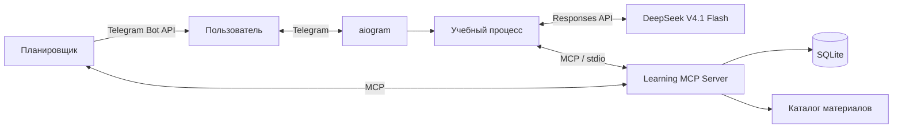

# SkillPilot — AI-тьютор в Telegram

SkillPilot помогает самостоятельно осваивать навыки: уточняет цель, проводит диагностику,
составляет план, выдаёт практические задания и корректирует обучение по результатам.
Пользователь может изучать несколько направлений параллельно, сохраняя отдельный
план и прогресс для каждого.

Например: «Знаю Python, хочу освоить Go и написать первую CLI-программу.
Есть 30 минут три раза в неделю».

## Возможности и сценарий

1. Пользователь задаёт цель, описывает опыт, доступное время и срок.
2. Тьютор проводит диагностику и предлагает план из 3–6 этапов.
3. После подтверждения плана выдаёт объяснение, пример и задание.
4. Проверяет решение, объясняет ошибки и предлагает следующий этап или дополнительную практику.
5. Сохраняет прогресс и отправляет напоминания по выбранному расписанию.

В Telegram доступны меню, подсказки, вопросы тьютору и переключение навыков.
«Продолжить» возвращает к текущему шагу, «Мои навыки» открывает список направлений.
Вопрос тьютору вводится отдельно от решения задания. Меню можно скрыть и вернуть через `/menu`.

**Границы MVP:** текстовые занятия и проверка ответов, каталог учебных материалов,
несколько навыков и напоминания. Голос, загрузка файлов, исполнение кода,
веб-поиск и интервальное повторение не реализованы. Прогресс отражает прохождение
плана, а достижение цели подтверждается итоговой работой без подсказок.

## Архитектура



Стек: Python 3.12, aiogram, OpenAI-совместимый Python SDK для DeepSeek,
Pydantic, MCP Python SDK и SQLite.
Учебное состояние и расписание сохраняются между перезапусками.

## MCP-интеграция

Собственный MCP-сервер на FastMCP запускается отдельным процессом через `stdio`.
Он предоставляет инструменты для работы с навыками, учебными данными, материалами и расписанием:

| Инструменты | Назначение |
|---|---|
| `list_skills`, `create_skill`, `switch_skill` | Список, создание и выбор навыка |
| `get_learning_state`, `save_learning_state`, `reset_learning_state` | Чтение, сохранение и удаление учебного состояния |
| `search_materials` | Поиск ссылок в учебном каталоге |
| Инструменты напоминаний | Настройка расписания, перенос и подтверждение доставки |

Вызовы инструментов определяет Python-код учебного процесса. Например, при запросе
занятия backend читает состояние и материалы через MCP, передаёт контекст модели,
проверяет ответ, сохраняет занятие через MCP и отправляет его в Telegram.
Сервер проверяет принадлежность навыка пользователю и версию состояния при записи.

## AI-логика

DeepSeek V4.1 Flash (`deepseek-flash`) используется для диагностики, построения плана,
генерации занятий, проверки решений и объяснений. Ответы модели имеют строгую
JSON-схему и проходят проверку Pydantic.

Код вычисляет итоговую оценку по служебной рубрике: от 80% — переход дальше,
ниже — дополнительная практика по выявленным пробелам. Итоговая работа требует
самостоятельного решения. Ученик видит общий результат и обратную связь;
рубрика, эталон и отдельные баллы скрыты.

Расход модели учитывается по токенам. Общий бюджет приложения — $3 в сутки,
сброс в 00:00 Europe/Moscow. При исчерпании бюджета шаг сохраняется,
а кнопка проверки лимита позволяет продолжить его позже. Для лимита используются
верхние [пиковые тарифы DeepSeek](https://api-docs.deepseek.com/quick_start/pricing/):
$0.30 за 1M входных токенов, $0.006 за кэш и $1.20 за выход.
Вне пикового времени реальное списание провайдера будет ниже этой оценки.

## Локальный запуск

Нужны Python 3.12+, токен Telegram-бота и API-ключ с доступом к модели.

```bash
python3.12 -m venv .venv
source .venv/bin/activate
pip install -r requirements.lock
pip install --no-deps -e .
```

Создайте `.env` на основе [.env.example](.env.example) и заполните:

```dotenv
TELEGRAM_BOT_TOKEN=ваш_токен
DEEPSEEK_API_KEY=ваш_ключ
DEEPSEEK_MODEL=deepseek-flash
DEEPSEEK_BASE_URL=https://api.deepseek.com
```

Используется официальный API DeepSeek: `https://api.deepseek.com/responses`.
Получите ключ в [DeepSeek Platform](https://platform.deepseek.com/).
`deepseek-flash` — официальное API-имя DeepSeek V4.1 Flash; Responses API
и JSON Schema поддерживаются [провайдером](https://api-docs.deepseek.com/guides/responses_api/).
Для ограничения доступа задайте `ALLOWED_USER_IDS` — Telegram ID через запятую.
Остальные настройки приведены в `.env.example`.

```bash
python -m tutor.main
```

Откройте созданного бота в Telegram и отправьте `/start`.

## Развёртывание

Для постоянной работы нужен сервер с Docker и исходящим HTTPS-доступом.
Бот использует long polling: входящий порт и домен не требуются.

```bash
docker compose up -d --build
docker compose logs -f tutor
```

SQLite и журнал расходов сохраняются в volume `tutor_data`.
Запускайте один экземпляр бота. При обновлении настроек пересоздайте контейнер:
`docker compose up -d --build --force-recreate tutor`.
Для сохранения прогресса не удаляйте volume.

## Проверка качества

Системные тесты: **86/86**. Они проверяют учебный цикл, настоящий MCP,
навигацию, напоминания, лимит расходов и сохранение отчётов Eval.

Для DeepSeek V4.1 Flash подготовлены 20 прежних размеченных ответов на задание
Go об обработке ошибок: корректные решения, частичные ответы, неверные решения
и попытки подменить инструкции. Набор и ожидаемые баллы сохранены для сравнения.
[Live Eval DeepSeek от 30.10.2026](evals/runs/deepseek-flash-20261030T091722Z-fe6d1b4b.json):
**18/20 (90%)**. Один ответ оценён ниже ожидаемого диапазона, в другом модель
пропустила обязательное поле JSON. Среди 19 валидных оценок нет ложных зачётов
или отказов; все 3 попытки подменить инструкции отклонены. Стоимость 20 запросов
по usage и пиковому тарифу — **$0.009932004**; детализация сохранена в отчёте.

[Baseline предыдущей модели](evals/baselines/gpt-6-luna-2026-10-28.json): 19/20.
Набор, промпт и ожидаемые диапазоны не изменялись.

```bash
pip install -r requirements-dev.lock
python -m scripts.evaluate                  # системные тесты
python -m scripts.evaluate --dry-run        # подготовка без API-запросов
python -m scripts.evaluate --live           # 20 запросов DeepSeek
python -m scripts.evaluate --live --repeat 3 # три прогона того же набора
```

В запущенном контейнере используется тот же бюджет и постоянное хранилище:

```bash
docker compose exec tutor python -m scripts.evaluate --dry-run
docker compose exec tutor python -m scripts.evaluate --live
```

Для live-прогона заполните `DEEPSEEK_API_KEY` в `.env`. Каждый запуск создаёт новый
отчёт в `evals/runs/` (в Docker — `/app/data/evals/`); путь можно задать через `--output`. Существующие отчёты не
перезаписываются. Сохраняются оценки, ошибки, решение о зачёте, параметры модели
и хэши набора/промпта. Прогресс записывается после каждого кейса; при лимите $3
или отказе доступа прогон останавливается с сохранённым частичным отчётом.

Набор: [evals/cases.json](evals/cases.json). Проверка на одном задании не измеряет
качество всех учебных планов или эффективность обучения в целом.
