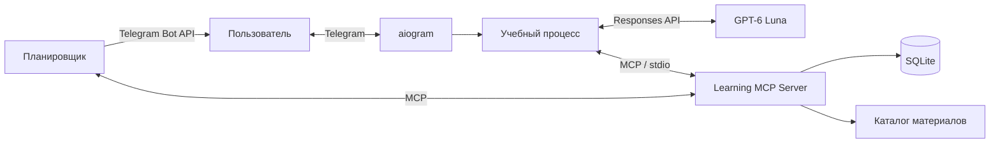

# SkillPilot — AI-тьютор в Telegram

SkillPilot помогает самостоятельно осваивать навыки: уточняет цель, проводит диагностику,
составляет план, выдаёт практические задания и корректирует обучение по результатам.
Пользователь может изучать несколько направлений параллельно, сохраняя отдельный
план и прогресс для каждого.

Например: «Знаю Python, хочу освоить Go и написать первую CLI-программу.
Есть 30 минут три раза в неделю».

## Возможности и сценарий

1. Пользователь задаёт цель, описывает опыт, доступное время и срок.
2. Тьютор проводит диагностику и предлагает план из 3–6 этапов.
3. После подтверждения плана выдаёт объяснение, пример и задание.
4. Проверяет решение, объясняет ошибки и предлагает следующий этап или дополнительную практику.
5. Сохраняет прогресс и отправляет напоминания по выбранному расписанию.

В Telegram доступны меню, подсказки, вопросы тьютору и переключение навыков.
«Продолжить» возвращает к текущему шагу, «Мои навыки» открывает список направлений.
Вопрос тьютору вводится отдельно от решения задания. Меню можно скрыть и вернуть через `/menu`.

**Границы MVP:** текстовые занятия и проверка ответов, каталог учебных материалов,
несколько навыков и напоминания. Голос, загрузка файлов, исполнение кода,
веб-поиск и интервальное повторение не реализованы. Прогресс отражает прохождение
плана, а достижение цели подтверждается итоговой работой без подсказок.

## Архитектура



Стек: Python 3.12, aiogram, OpenAI Python SDK, Pydantic, MCP Python SDK и SQLite.
Учебное состояние и расписание сохраняются между перезапусками.

## MCP-интеграция

Собственный MCP-сервер на FastMCP запускается отдельным процессом через `stdio`.
Он предоставляет инструменты для работы с навыками, учебными данными, материалами и расписанием:

| Инструменты | Назначение |
|---|---|
| `list_skills`, `create_skill`, `switch_skill` | Список, создание и выбор навыка |
| `get_learning_state`, `save_learning_state`, `reset_learning_state` | Чтение, сохранение и удаление учебного состояния |
| `search_materials` | Поиск ссылок в учебном каталоге |
| Инструменты напоминаний | Настройка расписания, перенос и подтверждение доставки |

Вызовы инструментов определяет Python-код учебного процесса. Например, при запросе
занятия backend читает состояние и материалы через MCP, передаёт контекст модели,
проверяет ответ, сохраняет занятие через MCP и отправляет его в Telegram.
Сервер проверяет принадлежность навыка пользователю и версию состояния при записи.

## AI-логика

GPT-6 Luna (`gpt-6-luna`) используется для диагностики, построения плана,
генерации занятий, проверки решений и объяснений. Ответы модели имеют строгую
JSON-схему и проходят проверку Pydantic.

Код вычисляет итоговую оценку по служебной рубрике: от 80% — переход дальше,
ниже — дополнительная практика по выявленным пробелам. Итоговая работа требует
самостоятельного решения. Ученик видит общий результат и обратную связь;
рубрика, эталон и отдельные баллы скрыты.

Расход модели учитывается по токенам. Общий бюджет приложения — $3 в сутки,
сброс в 00:00 Europe/Moscow. При исчерпании бюджета шаг сохраняется,
а кнопка проверки лимита позволяет продолжить его позже.

## Локальный запуск

Нужны Python 3.12+, токен Telegram-бота и API-ключ с доступом к модели.

```bash
python3.12 -m venv .venv
source .venv/bin/activate
pip install -r requirements.lock
pip install --no-deps -e .
```

Создайте `.env` на основе [.env.example](.env.example) и заполните:

```dotenv
TELEGRAM_BOT_TOKEN=ваш_токен
OPENAI_API_KEY=ваш_ключ
OPENAI_MODEL=gpt-6-luna
OPENAI_BASE_URL=https://api.openai.com/v1
```

Можно указать совместимый API-шлюз с поддержкой Responses API и Structured Outputs.
Для ограничения доступа задайте `ALLOWED_USER_IDS` — Telegram ID через запятую.
Остальные настройки приведены в `.env.example`.

```bash
python -m tutor.main
```

Откройте созданного бота в Telegram и отправьте `/start`.

## Развёртывание

Для постоянной работы нужен сервер с Docker и исходящим HTTPS-доступом.
Бот использует long polling: входящий порт и домен не требуются.

```bash
docker compose up -d --build
docker compose logs -f tutor
```

SQLite и журнал расходов сохраняются в volume `tutor_data`.
Запускайте один экземпляр бота. При обновлении настроек пересоздайте контейнер:
`docker compose up -d --build --force-recreate tutor`.
Для сохранения прогресса не удаляйте volume.

## Проверка качества

Системные тесты: **77/77**. Они проверяют учебный цикл, настоящий MCP,
хранение данных, навигацию, напоминания и ограничение расходов.

Live Eval от **28.10.2026**: GPT-6 Luna, reasoning effort `low`, 20 заранее
размеченных ответов на одно задание Go об обработке ошибок.

| Метрика | Результат |
|---|---|
| Совпадение оценки с ожидаемым диапазоном | 19/20 — 95% |
| Совпадение решения о зачёте при пороге 80% | 20/20 |
| Корректный формат ответа и состав критериев | 20/20 |
| Отклонённые попытки подменить инструкции | 3/3 |

**Разбор расхождения:** за код, который выводит ошибку, но продолжает использовать
результат, модель поставила 75% вместо ожидаемых 50%. Обратная связь верно описала
проблему; расхождение связано с частичным баллом за обработку ошибки. Для следующего
прогона нужно уточнить рубрику. Ложного зачёта не произошло: 75% ниже порога 80%.

Набор кейсов: [evals/cases.json](evals/cases.json).
Результаты: [live Eval](evals/live-results.json), [системные тесты](evals/system-results.json).
Это один прогон на одном задании; он не измеряет качество всех учебных планов
или эффективность обучения в целом.

```bash
pip install -r requirements-dev.lock
python -m scripts.evaluate         # системные тесты
python -m scripts.evaluate --live  # запросы к реальной модели
```
